# DistractFree

**[distractfree.site](https://distractfree.site)**

DistractFree helps you focus when you study or work. You start a focus session, and our Chrome extension blocks the sites that distract you, like YouTube, Instagram or Reddit, until the session ends. Each session you finish earns Focus Coins. You can spend those coins to unlock a blocked site when you really need a break.

The website is where you plan your sessions and see how you are doing. It learns from your past sessions to predict how likely a new one is to go to plan, and it suggests the best time and length for your next session.

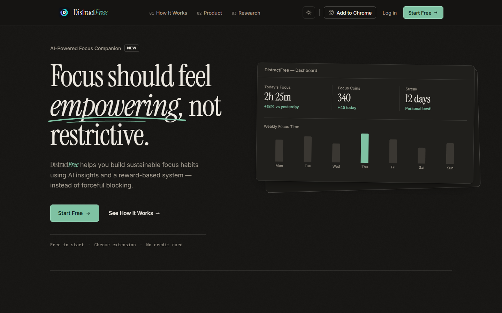

## What you can do

### Dashboard
See today's focus time, your progress toward your daily goal, coins earned, your streak, and the last 7 days. It also shows a forecast of how a session started right now is likely to go, and the best time for your next session.

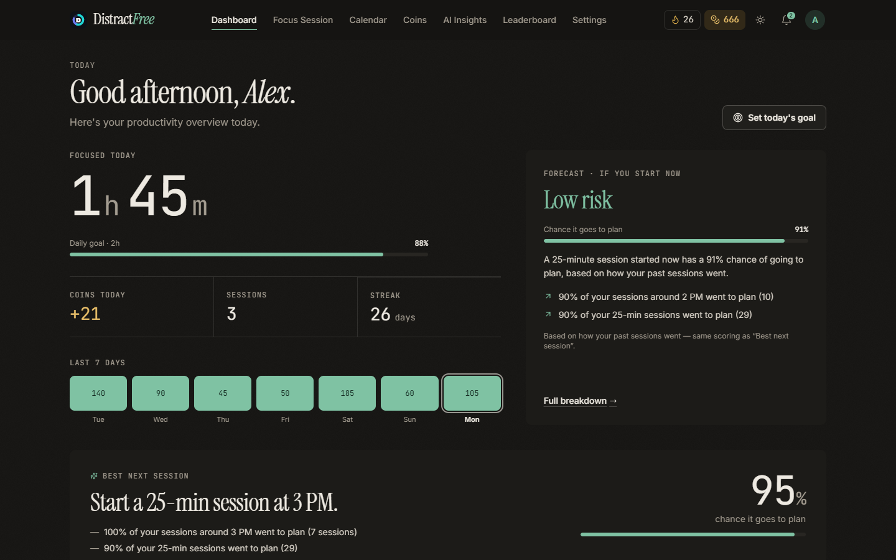

### Focus sessions
Pick a length: 25, 50, 90 or 120 minutes, or set your own. Then start. While the session runs, the extension blocks your distracting sites and the website shows whether you are focused, drifting or distracted.

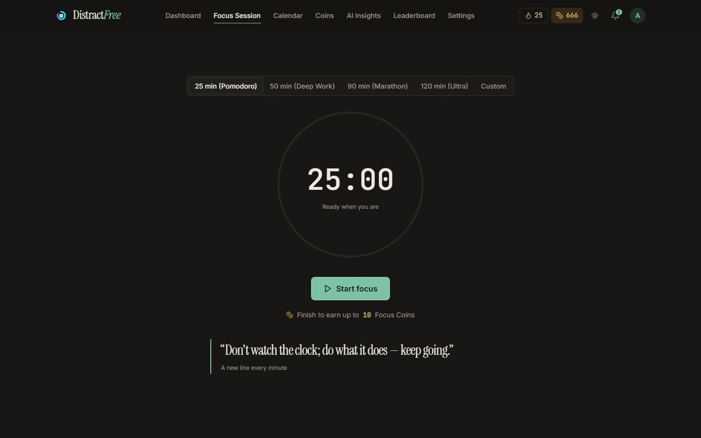

### Calendar
Plan sessions ahead of time, once or repeating daily or weekly. They start automatically at their time, and you get a reminder 10 minutes before.

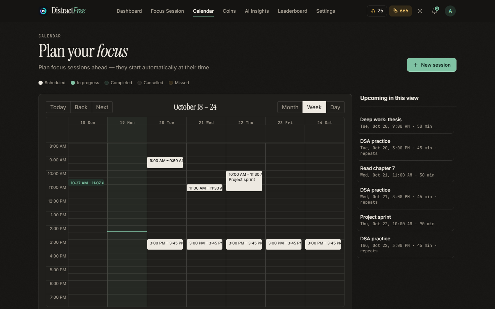

### AI insights
See when you focus best. DistractFree predicts your chance of finishing a session, explains why, and suggests a better start time or length. It also shows your focus score for the last 7 days.

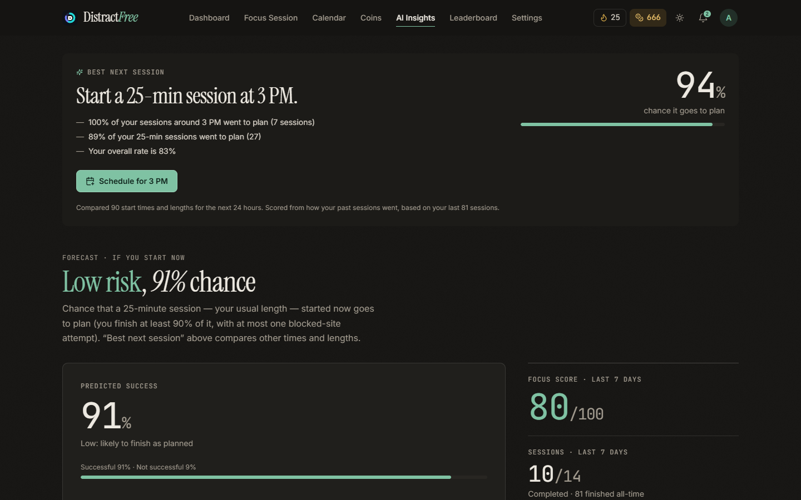

### Focus coach
A chat on your dashboard, powered by Google Gemini. Ask it things like "When do I focus best?" or "Why did my last sessions fail?" and it answers from your own numbers, the same ones the pages show. Ask it to "plan 2 sessions for tomorrow" and it suggests times, each with its predicted chance of success. Nothing is saved until you press Confirm.

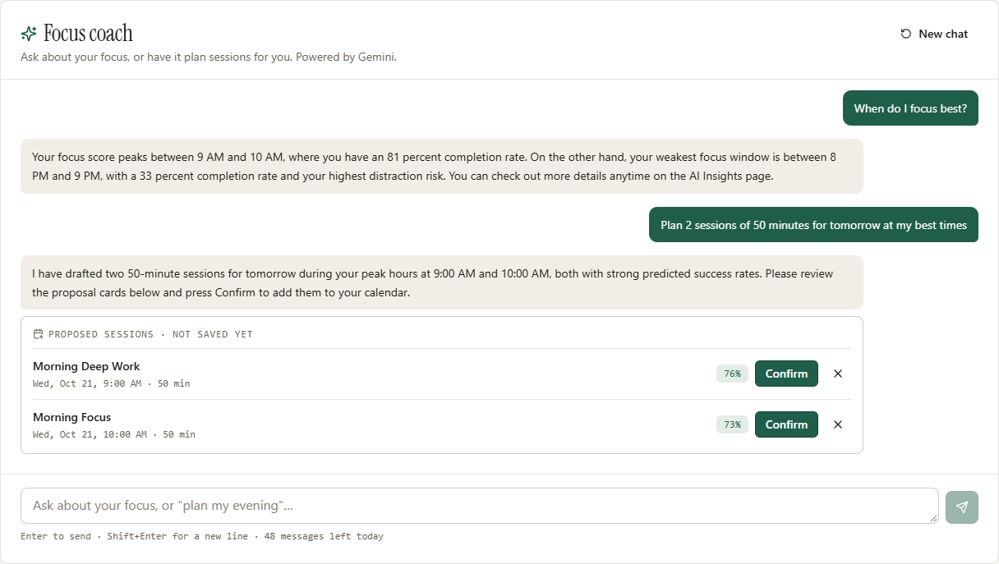

It can also help with your blocked sites. It shows which sites distract you during sessions and suggests turning on strict mode if you often unlock sites with coins. You tick the changes you want and press Apply. Removing a site or turning strict mode off asks you twice.

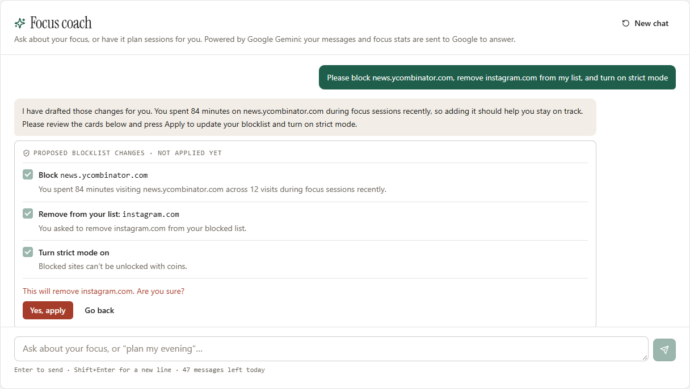

### Weekly report
Every Monday you get a report on last week: your focus time compared with the week before, how many sessions went to plan, your best day and start time, what went well, what slipped, and one goal for this week. Schedule the goal in one click, or ask the coach about it. Turn on "Email my weekly report" in Settings to get it in your inbox too.

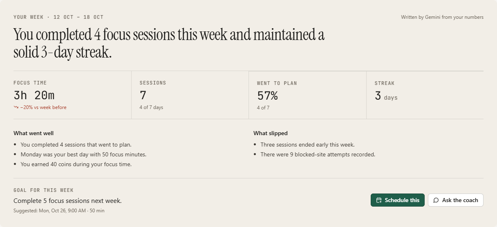

### Productivity heatmap
A year of focus in one view, with your best month, best week, most productive day and longest streak.

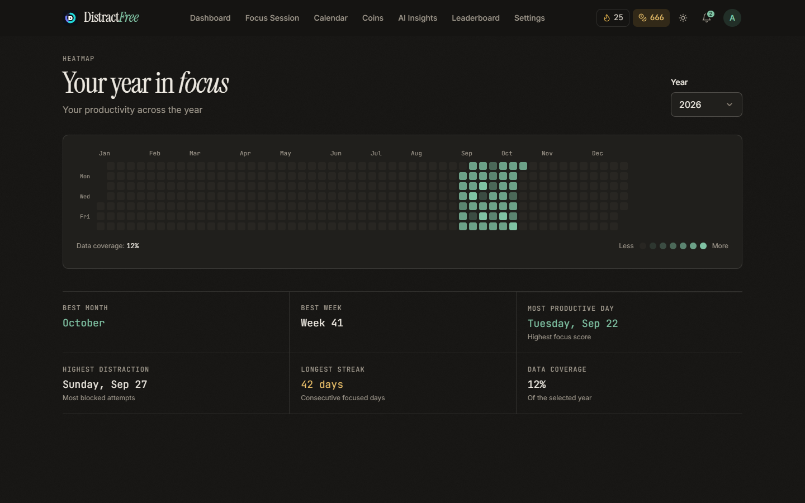

### Focus Coins
Every finished session earns coins, and new users start with a 20-coin welcome bonus. Spend 5 coins to unlock a blocked site during a session. This page shows your balance and every coin you earned or spent.

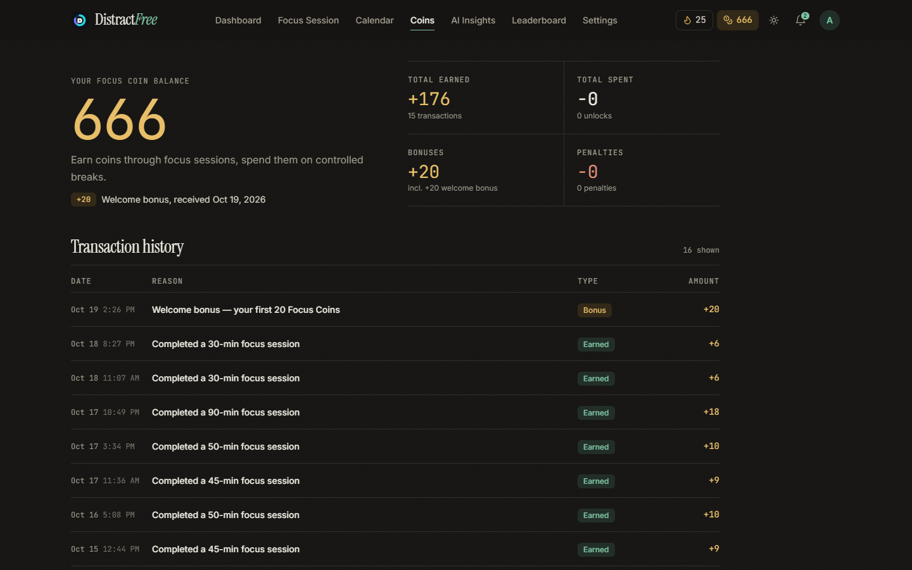

### Leaderboard
See how your focus time compares with other users this week or all time.

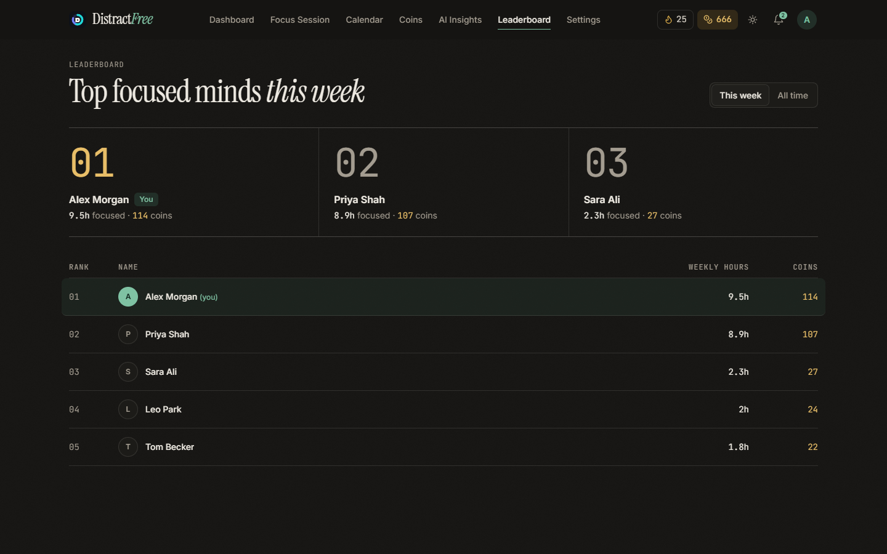

### Settings
Choose which sites to block and turn each one on or off. Strict mode stops blocked sites from being unlocked with coins.

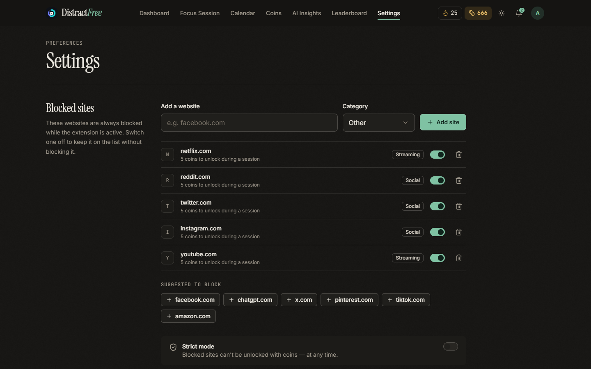

## Getting started

1. Go to [distractfree.site](https://distractfree.site) and sign up with Google or with your email.
2. Add the DistractFree extension to Chrome.
3. Choose the sites to block in Settings, then start your first focus session.

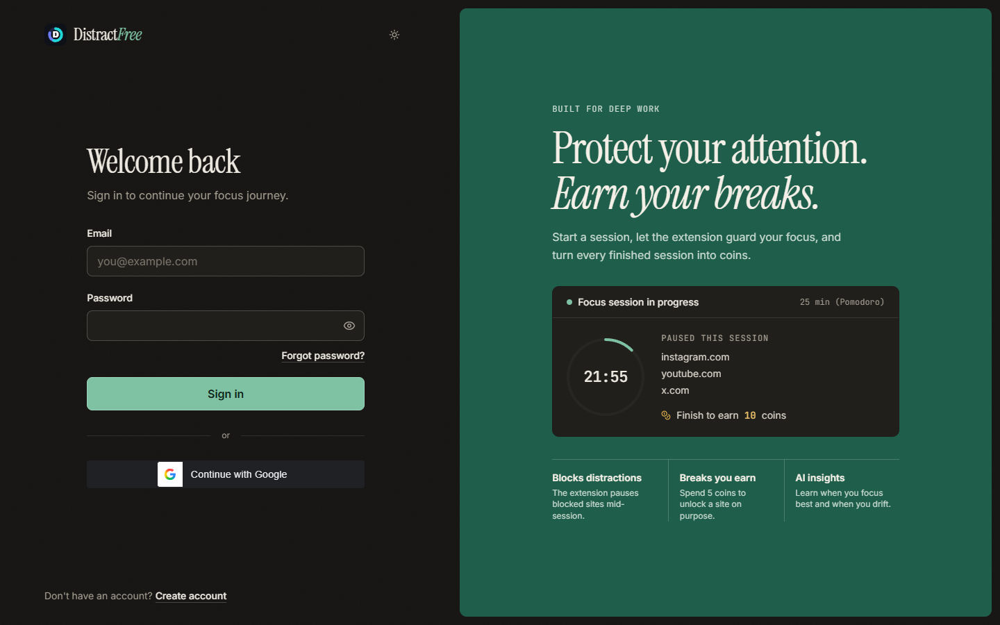
